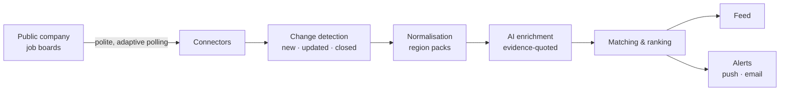

<div align="center">

# Earlii

**Be first to the roles that will actually consider you.**

Earlii watches public company job boards and tells you about fresh roles that fit you, minutes after they are posted.
It takes the busywork out of job hunting (finding, filtering, tracking, drafting and reminding) and leaves you
the two moments that should stay human: pressing **send** and pressing **submit**.

[](#status)
[](#scope)
[](#stack)
[](#stack)
[](LICENSE)

[What it does](#what-it-does) · [How it works](#how-it-works) · [Principles](#principles) · [Stack](#stack) · [Roadmap](#roadmap) · [License](#license)

</div>

---

## What it does

| | Capability | What you get |
| :-: | :-- | :-- |
| ⚡ | **Fresh-roles feed** | Roles ranked by freshness × fit, with a "12 min ago" badge and honest "why this matches" chips. |
| 🔔 | **Alerts that respect you** | Saved searches delivered by push or email digest, with smart batching, quiet hours and daily caps. |
| 🔍 | **Evidence-backed summaries** | Must-haves, level, work mode and salary, each linked to the exact sentence in the posting. When something is missing it says "not stated", never a guess. |
| 🗂️ | **Application tracker** | Saved → Applied → Interview → Offer, with timelines, follow-up reminders and CSV export. |
| ✍️ | **Claim-checked drafts** | Cover letters and referral asks in which every claim about you maps to a line in your resume. |
| 🤝 | **Referral finder** | Matches your own LinkedIn connections export to fresh roles. Stays private and can be deleted anytime. |

## How it works



1. **Connectors** read only public, documented job-board feeds. Busy boards are checked every 15 minutes, quiet ones daily, and a board is promoted the moment it starts posting.
2. **Change detection** diffs every board by stable job ID. The first-seen time becomes the freshness clock. Reposts and duplicates are caught before they reach you.
3. **Region packs** normalise locations, titles, salaries and experience for each country. India comes first; each new country ships only after a consistency suite passes.
4. **Enrichment** runs once per posting version, is shared by every user, and stores a verbatim evidence quote for every field.
5. **Matching** runs incrementally on new postings and never re-scores every user in a batch.

## Principles

**Built for impatient people.**
- Value in under 60 seconds, with no sign-up wall before your first feed.
- Every tap answers in under 100 ms. Searches answer while you type, in under 200 ms.
- Never a blank screen: cached content first, skeletons second, spinners never.
- Undo instead of "are you sure?".

**Fast, but never noisy.** Posted-to-alert targets are under 20 minutes on busy boards and under 70 minutes on normal ones. Batching, quiet hours and one-tap mute keep that speed from turning into spam.

**Honest by construction.** Every extracted fact carries its source. Every draft is checked against your resume. An eval suite gates every AI change.

### What Earlii will never do

- Scrape LinkedIn or Naukri, or automate any platform that forbids it.
- Send an email or message, or submit an application, on your behalf.
- Keep a database of recruiters' personal contact details.
- Write a claim about you that your resume doesn't support.
- Sell or share your data, run ads, or charge recruiters to reach you.
- Send your resume or drafts to a free LLM tier.

## Scope

- **Who it's for:** corporate professionals across job categories.
- **Market:** India first. Other countries come later as region packs (data, rules and connectors), never as core rewrites.
- **Clients:** a React PWA first, then a React Native app sharing the same design language.
- **Pricing (planned):** Free · Pro ₹199/month · Search Season ₹449 for 3 months · Campus seats.

## Stack

| Layer | Choice |
| :-- | :-- |
| Backend | Go modular monolith, Connect RPC with Protobuf contracts |
| Data | PostgreSQL, sqlc for typed SQL, River for background jobs |
| Web | React, TypeScript, Vite, TanStack Router and Query, Tailwind, shadcn/ui |
| Mobile | React Native with Expo, NativeWind, React Native Reusables |
| AI | Gemini Flash-class model behind a provider interface, gated by evals |
| Observability | OpenTelemetry → Grafana Cloud |
| Delivery | One Docker image, with each mode (API, worker, scheduler) in its own container |

## Repository layout

```text
earlii/
├── backend/     Go services: API, workers, connectors, pipelines
├── apps/        Web PWA and (later) the mobile app
├── packages/    Shared design tokens and generated clients
├── proto/       Protobuf contracts (the API's single source of truth)
└── docs/        Spec, roadmap, handbook, ADRs and standards
```

## Roadmap

| Phase | Goal |
| :-- | :-- |
| **0 · Bootstrap** | Tooling, CI, contracts and an empty skeleton that runs end-to-end |
| **1 · Data platform** | Company registry, Greenhouse and Lever connectors, change detection, India pack |
| **2 · Personal MVP** | Guest feed, filters, search, sign-in, saved searches and email digest |
| **3 · Public beta** | AI enrichment with evals, resume parsing, push alerts, tracker, mobile app |
| **4 · Paid launch** | Plans and billing, drafts, follow-ups, referrals, insights |

## Status

Pre-alpha and under active development. Nothing here is production-ready yet.

## License

Copyright © 2026 Nadeem Ashraf. All rights reserved.

This repository is publicly visible but it is **not open source**. No licence to use, copy, modify or distribute
any part of it is granted. See [LICENSE](LICENSE) for the full terms.

<div align="center">
<sub>Made in India · <a href="https://github.com/devnadeemashraf">@devnadeemashraf</a></sub>
</div>
