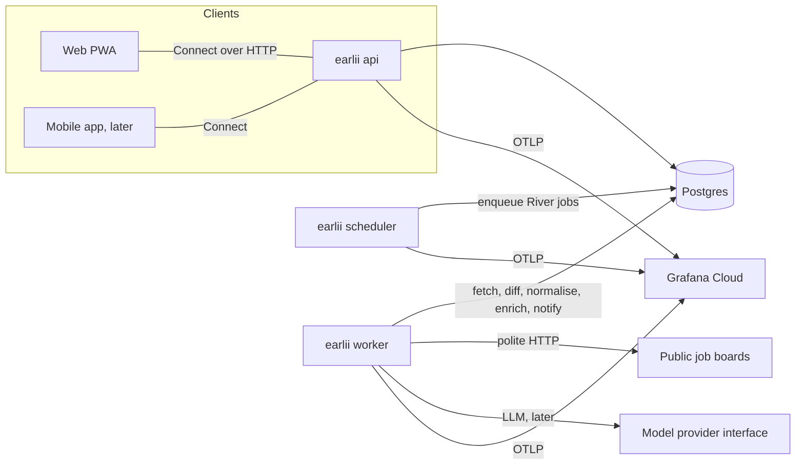

# Earlii developer handbook

Updated incrementally, as part of every PR that changes what it describes. Sections for things not built yet say **(planned, <ID>)**.

## 1. Orientation

Earlii polls public company job boards, detects new roles within minutes, normalises them for India, and serves a personal feed and alerts. Read in this order: SPEC (`docs/SPEC.md`: what and why; **private, local-only and gitignored**, so it isn't on GitHub) → [ROADMAP](ROADMAP.md) (what's next) → [POINTER](POINTER.md) (where we are) → this handbook (how it works) → [CODING_STANDARDS](CODING_STANDARDS.md).

One person maintains everything, with AI help. Optimise for code that is easy to change, test and operate, not for code that is clever.

## 2. Glossary

| Term | Meaning |
| :-- | :-- |
| Board | One company's careers feed at one provider (e.g. a Greenhouse board token) |
| Provider | A job-board/ATS vendor with a public API (Greenhouse, Lever, …) |
| Connector | Code that reads one provider's public feed into raw postings |
| Posting | A job as published. It has a **stable ID** from the provider and **versions** keyed by content hash |
| First seen | When Earlii first saw a posting: the freshness clock |
| Region pack | Per-country data and rules: location tree, title/salary/experience rules, connector list |
| Enrichment | Per-posting-version LLM extraction, where every field has a verbatim evidence quote or "not stated" |
| Mode | The role a single `earlii` binary runs as: `api`, `worker` or `scheduler` |
| POINTER | `docs/POINTER.md`, the session handoff file |
| BP-xxx | A bug from an earlier PR, queued in POINTER's FIX-FIRST QUEUE |
| SCP-xx | A Spec change proposal (ROADMAP) |
| D-xx | An open or closed decision (ROADMAP section Decisions) |
| Study guide | The owner's private, per-PR explanation of a PR's concepts, code, internals and decisions, with labs (`docs/learning/`, gitignored, never committed) |

## 3. Repo map

```text
earlii/
├── AGENTS.md                 Agent instructions (single source); CLAUDE.md imports it
├── Taskfile.yml              Task runner: setup, doctor, check, fmt, gen, lint, test, build:web, dev, dev:db, migrate, handoff
├── buf.yaml                  buf: the proto/ module, STANDARD lint and FILE breaking rules (ADR-0006)
├── buf.gen.yaml              buf generate: local plugins (go tool protoc-gen-go/-connect-go, protoc-gen-es)
├── compose.yaml              Local stack: Postgres 18 and grafana/otel-lgtm, loopback-only ports (P0-04)
├── go.work                   Go workspace: lists every Go module (today only backend/); go.work.sum is its checksums
├── mise.toml                 Tool version pins (local + CI)
├── lefthook.yml              Git hooks: format, secrets, commit-msg, pre-push
├── biome.json                TS/JS/JSON/CSS format + lint (Markdown excluded; Tailwind directives on)
├── .golangci.yml             Go lint + formatters (gofumpt, goimports)
├── package.json              pnpm workspace root: Biome, TypeScript, Vite, Vitest (exact pins)
├── tsconfig.base.json        Shared strict TS options; every TS project extends it and adds the @/* alias (ADR-0004)
├── pnpm-workspace.yaml       Workspace globs: apps/*, packages/*
├── scripts/                  Repo automation, zero dependencies, tested with node:test
│   ├── lib/                  Pure logic: conventional commits, guards, handoff, pins, shell parsing,
│   │                         bundle budget, app icon + PNG encoder, migration rules
│   ├── claude/               Claude Code hook entry points (session-start, guard-bash, guard-edit, post-edit-format)
│   ├── test/                 Tests for all of the above, plus config-parsing tests
│   │   └── fixtures/ts-alias/ Reference TS project proving @/* in tsc, Vitest, Vite dev and build
│   ├── check-migrations.mjs  lint:migrations: forward-only rules against main (ADR-0005)
│   ├── check-text.mjs        Banned-character scan (the section sign) for files and staged changes
│   ├── check-web-build.mjs   build:web: production build, stale route tree check, initial-JS budget
│   ├── check-gen.mjs         lint:gen: buf output regenerated into a temp dir and compared (ADR-0006)
│   ├── check-proto-breaking.mjs lint:proto: buf breaking against main's merge base
│   ├── render-icons.mjs      Regenerates the web app's PNG icons (a test fails if they're stale)
│   ├── doctor.mjs            Tool pin check
│   ├── handoff-check.mjs     POINTER/HANDBOOK rule (CI + local)
│   ├── commit-msg.mjs        commit-msg hook
│   └── pre-push-guard.mjs    pre-push hook
├── .claude/                  Claude Code: settings (hooks, permissions, attribution off), skills, subagents
├── .mcp.json                 MCP servers: gopls, playwright, context7 (optional)
├── .github/                  CI workflow, Dependabot, PR template
├── docs/                     Spec, roadmap, pointer, handbook, standards, versions, setup, ADRs
│   └── learning/             Private study guides and labs, one folder per PR (gitignored, never committed)
├── backend/                  Go module github.com/devnadeemashraf/earlii/backend
│   ├── sqlc.yaml             sqlc: schema = migrations, queries = internal/postgres/queries, out = gen/db
│   ├── cmd/earlii/           The one binary: mode dispatch, logger, signals, migrate (main.go)
│   ├── gen/db/               sqlc output (package db); generated, never edited (task gen)
│   ├── gen/api/              buf output: earlii/v1 (messages, package earliiv1) and earliiv1connect (Connect)
│   └── internal/
│       ├── config/           Env-only config: parse, validate, fail fast with every error; Secret
│       ├── health/           Checker (concurrent checks, shared runs, 1 s cache), /healthz and /readyz
│       ├── rpc/              Connect server: services (Health), interceptors (request ID, access log, recovery), Mount
│       ├── httpserver/       Hardened http.Server (New) and graceful Serve (errgroup + Shutdown)
│       └── postgres/         Pool (NewPool), Migrate (River then goose under one advisory lock)
│           ├── migrations/   Forward-only goose SQL files, embedded in the binary
│           ├── queries/      sqlc query files
│           └── pgtest/       Integration-test helper: throwaway databases on a loopback server
├── apps/web/                 The React PWA (P0-03): Vite, TanStack Router + Query, Tailwind, shadcn/ui
│   ├── index.html            Inline first-paint skeleton + critical CSS, manifest and theme-color links
│   ├── vite.config.ts        Plugins, the @/ alias, dev-server lock-down (fs, proxy), Vitest settings
│   ├── components.json       shadcn/ui config (aliases use @/)
│   ├── public/               manifest.webmanifest, icon.svg and the rendered PNG icons
│   └── src/
│       ├── main.tsx          Entry: builds the QueryClient and router, then mountApp
│       ├── mount.tsx         Loads the first route, then mounts React (no blank flash)
│       ├── router.ts         createAppRouter: route tree, context, pending and preload defaults
│       ├── routeTree.gen.ts  Generated by the router plugin; committed; never edited by hand
│       ├── routes/           File routes: __root.tsx (shell, not-found, root error), index.tsx (/)
│       ├── components/       App components (api-status) and ui/ (copied shadcn components)
│       └── lib/              api-status (the Health client adapter), copy, query-client, router-context, utils
├── packages/
│   └── api/                  @earlii/api: generated TS contracts (src/gen), source-only; design tokens come in P2-01
└── proto/earlii/v1/          Protobuf contracts (health.proto); the source of backend/gen/api and packages/api
```

## 4. Architecture

The architecture is set in ADRs: a **modular monolith** ([ADR-0003](adr/0003-modular-monolith-one-image.md)) built as one Go binary and one Docker image, running in several modes. Contracts are **Connect RPC + Protobuf** ([ADR-0002](adr/0002-connect-rpc-protobuf-contracts.md)).



- **Module boundaries** (planned, P1-01 onward): `internal/<module>/` per bounded area (registry, connectors, pipeline, feed, alerts, auth). Modules talk through Go interfaces in-process, and never by reaching into another module's tables.
- **Async work** goes through River jobs on Postgres. That avoids a separate broker on free tiers.

## 5. Runtime flows

### Boot and shutdown (P0-02)

`earlii <mode>` (`api`, `worker`, `scheduler` or `migrate`) runs `run()` in `backend/cmd/earlii/main.go`:

1. **Args.** Anything other than exactly one known mode prints the usage line to stderr and exits **2**.
2. **Logger.** A JSON `slog` logger on stdout, with UTC timestamps and a `mode` attribute. It is built *before* config so config errors are JSON too; its level (`slog.LevelVar`) is set after config loads.
3. **Config.** `config.Load(os.Environ())` validates everything and reports every problem at once, naming variables but never echoing values. Invalid config logs one ERROR line and exits **1**.
4. **Signals.** `signal.NotifyContext` turns SIGINT/SIGTERM into a cancelled context. After the first signal the default handlers come back, so a second Ctrl-C kills the process at once.
5. **Migrate (one-shot).** `earlii migrate` applies the schema and exits 0, or 1 on failure; it never listens (see Schema and migrations below).
6. **Serve.** The other modes create a Postgres pool that connects lazily, so they boot while the database is down. They listen on `EARLII_HTTP_ADDR` and serve `GET /healthz` (always 200 while the process runs) and `GET /readyz` (200 only if every check passes within 2 s; 503 with per-check `ok`/`fail`, details only in the logs). The one check is `postgres` (`pool.Ping`). `api` mode also serves the Connect API (see Connect API below). Worker and scheduler only serve probes until River's client starts (P0-07).
7. **Drain.** `httpserver.Serve` runs two goroutines in an `errgroup`: one runs `srv.Serve`, the other waits for the signal (or a serving error) and calls `srv.Shutdown` with a fresh `EARLII_SHUTDOWN_TIMEOUT` budget. `Shutdown` stops accepting, closes idle keep-alive connections at once and waits for in-flight requests; if the budget runs out, `srv.Close` cuts off the rest and `Serve` returns an error wrapping `context.DeadlineExceeded`. Exit **0** on a clean stop, **1** on any serving error or forced close. `Shutdown` closes the listener first, so `/readyz` can't report "draining" to new probes. If a load balancer ever needs to deregister an instance before the drain, that takes a pre-stop delay (consider it in P0-06).

Every connection has limits (`internal/httpserver/server.go`): 5 s to read headers, 15 s to read the request, 15 s to write the response, 60 s idle, 64 KiB of headers. The global write timeout will cut off Connect server-streaming RPCs: streaming handlers must set their own deadline with `http.ResponseController` (P0-05).

### Configuration (environment only)

| Variable | Default | Rules |
| :-- | :-- | :-- |
| `EARLII_ENV` | **required** | `dev` or `prod`. Required, so prod never runs on dev defaults |
| `EARLII_HTTP_ADDR` | `:8080` | `host:port`; host empty, `localhost` or an IP; port 0 (random) is rejected in prod. The default binds every interface, as containers need; `task dev:api` overrides it (section 11) |
| `PORT` | none | Used as `:$PORT` only when `EARLII_HTTP_ADDR` is unset (Render sets it, default 10000) |
| `EARLII_DATABASE_URL` | **required** | A pgx URL (`postgres://...` or keyword/value). Only host, port, user, password, dbname, sslmode, sslrootcert, connect_timeout, application_name and `pool_*` keys are allowed (no service files, passfiles or `options`). In prod the parsed result must authenticate the server on every host: `verify-full`, or `verify-ca` with `sslrootcert`. `require`, `prefer`, `ssl=true` and a `PGSSLMODE` downgrade are rejected. Any `PG*` variable pgx reads (`PGHOST`, `PGOPTIONS`, …) fails the boot. Held as `config.Secret`, which never prints. `connect_timeout` defaults to 5 s (0 counts as unset); the pool size defaults to pgx's, tune it with `pool_max_conns` |
| `EARLII_TEST_DATABASE_URL` | none | Integration tests only (loopback admin URL). The app tolerates it but never uses it |
| `EARLII_LOG_LEVEL` | `info` | `debug`, `info`, `warn` or `error` |
| `EARLII_SHUTDOWN_TIMEOUT` | `8s` | Go duration, above 0 and at most 9 s, so the drain finishes before Docker's SIGKILL at 10 s |

An empty value counts as unset. A variable set twice fails the boot. Unknown `EARLII_*` variables (any case) fail the boot unless `EARLII_ENV=prod`, where they are logged as warnings instead, so rolling back to an older image never crash-loops on a variable added for a newer one.

### Web boot and the home route (P0-03)

1. **First paint, before JS.** `index.html` ships critical CSS and a static copy of the home skeleton inside `#root`, with the light/dark background matching `src/index.css` and the manifest. It has no inline scripts or `on*` attributes, so a strict CSP (`script-src 'self'`) can be added later.
2. **Load, then mount.** `main.tsx` creates the QueryClient (`createQueryClient`: one retry, and only for `network` and `timeout` failures) and the router, whose context carries `{ queryClient, api }`. `mountApp` awaits `router.load()` (logging, not blocking on, a rejected load) and only then calls `createRoot().render()`. A bare `RouterProvider` commits an empty tree before its first match exists, which would wipe the inline skeleton (a test proves it). So React's first commit already holds the route's content or error, and the provider reuses that load.
3. **The `/` route.** The loader runs `queryClient.ensureQueryData(apiStatusQuery(api))`, and the component reads the same entry with `useSuspenseQuery`. On later navigations the route's `pendingComponent` (the React skeleton) shows after 100 ms and stays at least 300 ms (`defaultPendingMs`/`defaultPendingMinMs`, a first guess to tune on a phone). Routes preload on intent.
4. **The adapter** (`src/lib/api-status.ts`, P0-05) calls `HealthService.Check` through the generated client (`@earlii/api`) on a connect-web transport: same origin, Connect JSON, and a GET because the method has no side effects. A 5 s timeout is combined with Query's abort signal (`anySignal`, which falls back where `AbortSignal.any` is missing: Safari before 17.4, Chrome before 116). connect-web has no size limit or redirect option, so `createGuardedFetch` adds them: no redirects, no HTTP cache, at most 4 KB per body (error bodies too; a stalled body is cut off at the timeout), and a 200 must be `application/json`. The decoded response is then validated: at most 32 checks, `[A-Za-z0-9_.-]` names, `SERVING` (with no failing check) is `ok`, `NOT_SERVING` is `degraded` content, anything else is `format`. Connect `Unavailable` (a gateway 502, 503 or 504: the dev proxy when the API is down) maps to `network`, `DeadlineExceeded` to `timeout`, other codes to `http`. Every failure becomes an `ApiStatusError` with a failure kind, and the UI shows fixed copy for each kind (`src/lib/copy.ts`), never server text.
5. **Dev server.** `task dev:web` serves on localhost:5173, `task dev:web:lan` on the LAN for phone testing. Only `^/earlii\.v1\.HealthService/Check(\?|$)` is proxied, to `http://127.0.0.1:8080`: each procedure the app calls is listed exactly, never a prefix. `server.fs.allow` is limited to the app and `node_modules`, and `fs.deny` adds the private docs to Vite's defaults; otherwise anyone on the Wi-Fi could read `docs/SPEC.md` through `/@fs/`. `allowedHosts` stays at its default (never `true`).

### Connect API (P0-05, [ADR-0006](adr/0006-connect-v2-and-codegen.md))

- **Contracts** live in `proto/earlii/v1/`. `task gen` runs `buf generate` with local plugins pinned to their runtimes (Go `tool` directives, `packages/api`'s devDependency) into `backend/gen/api` and `packages/api/src/gen`. `task lint:gen` fails on stale output; `task lint:proto` runs `buf lint` and `buf breaking` against main's merge base (skipped until main has `buf.yaml`).
- **Server.** `rpc.NewServer(logger, checker)` builds a connect-go v2 server; `rpc.Mount` adds one route per procedure to the same mux as the probes, in `api` mode only. Limits: 64 KiB per request message (after decompression), gzip above 1 KiB, and the Connect protocol marker required (`Connect-Protocol-Version` on POST, `connect=v1` on GET), so a cross-site form, `` or `text/plain` request can't make a valid call.
- **Interceptors**, outermost first:
  1. **request ID**: a fresh 128-bit hex ID in ctx (`rpc.RequestID`) and the `X-Request-Id` response header; an inbound ID is never adopted;
  2. **access log**: one `rpc` line per call with procedure (a plain `/package.Service/Method` name of at most 128 bytes, else `unknown`), code, duration, request ID, protocol, codec, byte counts and a well-formed inbound `client_request_id`; ERROR for unknown, internal and data_loss, INFO otherwise;
  3. **recovery**: a panic becomes `internal` with fixed text; the value and stack go to an `rpc panicked` log line only.

  Unknown methods of a registered service go through the same chain (`SetUnknownHandler`): logged, and answered `unimplemented` with fixed text that doesn't echo the path. Requests rejected before the chain (405, 415, bad compression) aren't logged yet (P0-07).
- **Health.** `HealthService.Check` and `/readyz` read one `health.Checker`. Concurrent callers share one run; a finished report is reused for 1 s; a run is cancelled only when its last waiter leaves, and an abandoned run isn't cached. A failing dependency is a normal `STATUS_NOT_SERVING` response with per-check `ok`, never an error; the response says `Cache-Control: no-store`. Error text stays in the logs.
- **Errors.** Return `connect.NewError(code, "fixed text")` for anything the client should see. Any other error reaches the client as a bare code (connect-go v2 never serialises it).

### Schema and migrations (P0-04, [ADR-0005](adr/0005-migrations.md))

- **Local stack.** `task dev:db` starts `compose.yaml`: Postgres 18.6 on `127.0.0.1:5432` (user, password and database `earlii` / `earlii-dev-only` / `earlii`), and Grafana with OTLP on `localhost:3000`, `:4317` and `:4318`. Grafana has anonymous Admin, enforces the `localhost` Host header against DNS rebinding, and sits on its own network so it can't reach Postgres. `task dev` adds `task migrate`, `dev:api` and `dev:web`.
- **`postgres.Migrate`** takes a session advisory lock (`MigrateLockID`) on a dedicated connection, with `idle_session_timeout` off. The wait is capped at 2 minutes and respects Ctrl-C and SIGTERM; pgx sends a cancel request when it closes a cancelled connection, so the statement also stops server-side. Then it:
  - refuses Postgres older than 18;
  - applies River's migrations (`rivermigrate.Migrate`, 8 at v0.50.0), then ours (goose `Provider.Up` over the embedded `migrations/` files), on a two-connection pool with `lock_timeout = 5s`, so DDL never queues for long behind a long transaction;
  - checks that the lock connection is alive before our DDL;
  - unlocks.

  Concurrent migrators apply each version once; the rest wait, then find nothing to do. It logs `migrated` with the versions applied (empty lists on a no-op).
- **Rules** (`task lint:migrations`): files are `NNNNN_snake_case.sql` with only `-- +goose Up`. A merged file is never edited, renamed or deleted, and a new version must be above main's highest. Breaking changes go expand, migrate, contract across releases.
- **sqlc** reads the migrations as its schema and `internal/postgres/queries/*.sql` as queries, and generates `backend/gen/db` (pgx/v5). `task lint:sql` fails if `gen/db` is stale. The first query, `ServerVersionNum`, is how migrate checks the server.
- **Direct connection.** The migrate URL must reach Postgres directly: a transaction-mode pooler would split the lock and the DDL across backends.

### Other flows

- Request path: web → Connect → handler → sqlc → Postgres (Connect since P0-05; the first query-backed RPC comes later)
- Fetch cycle: scheduler → River job → connector → change detection → normalisation (planned, P1-03 – P1-07)
- Alert fan-out: new posting → incremental match → digest/push (planned, P2-12, P2-13)

## 6. Data and content pipeline

(planned, P1-01 – P1-12) Registry → polite fetch → change detection (stable ID + content hash) → India normalisation → dedupe → (Beta) enrichment with evidence → matching.

## 7. Testing strategy

- **Repo scripts:** `node:test` in `scripts/test/`. Pure logic lives in `scripts/lib/`, so the rules are unit-tested without git. The CLIs are also tested end to end through `spawnSync`.
- **Go:** table-driven unit tests next to the code, external test packages (`package x_test`) so tests use only the public API. `task test:go` adds `-race` when cgo is on (Linux CI); the Windows dev box has no gcc, so it runs without. Server tests bind `127.0.0.1:0` and synchronise with channels, never sleeps. **Integration tests** (P0-04, D-10) are `*_integration_test.go` files with `//go:build integration`. `task test:integration` runs them against `EARLII_TEST_DATABASE_URL`, or the running compose Postgres, and prints `skip:` when neither is available. In CI they run in the `integration` job against a `postgres:18.6-alpine` service container. `pgtest.NewDatabase(t)` gives each test a fresh database (`earlii_test_<16 hex>`), force-dropped at cleanup. The admin URL must be loopback, and an unset URL fails rather than skips. golangci-lint lints them (`build-tags: [integration]`). Coming next: connector fixtures with no live network in CI.
- **Web:** Vitest + Testing Library, jsdom by default; files that need Node (the Health client adapter, the PWA contract, the dev server) start with `// @vitest-environment node`. Route tests render the real route tree with `createMemoryHistory`, a fake `api` in the router context and a QueryClient with `retry: false` (`createQueryClient`). The dev-server test boots the real Vite config and attacks it (`/@fs/`, traversal, a foreign Host, proxy route variants). The Health adapter is tested against a mock transport (`createRouterTransport` from `@connectrpc/connect`) and a real transport over a fake `fetch`.
- **RPC:** handler tests call the generated client over `connectinprocess` (no listener); wire tests mount the server on a mux behind `httptest.NewServer` and send raw requests where the generated client would normalise them. `export_test.go` files expose test-only hooks (`rpc.NewServerWith`, `health.Waiters`). Playwright e2e for the key flows comes in P2-04 and P2-05.
- **Required paths for every change:** happy, sad, edge and abuser. See CODING_STANDARDS section Tests.

## 8. Performance budgets

The canonical budgets live in [ROADMAP section Budgets](ROADMAP.md#budgets). How each is measured is added here as each budget gets a gate (planned, P0-06, P2-03, P2-07).

- **Web initial JS** (gated since P0-03): `task build:web` (part of `task check`, before the tests so Vitest can't regenerate the route tree first) runs the app's Vite with Node (no shell) and `--manifest`, then `scripts/check-web-build.mjs` sums the gzip size (Node's default level) of the entry chunk and its static imports, transitively. Lazily loaded route chunks don't count. The manifest is deleted afterwards, so `dist/` doesn't ship it. It fails above 170 kB (1 kB = 1000 bytes, as Vite reports). It was 112.93 kB before P0-05, almost all React, React DOM, TanStack Router and Query; P0-05's Connect and Protobuf runtimes took it to 144.92 kB (the binary codec makes no difference).

## 9. Security model

- **Agent guardrails** (built): hooks deny secret, generated and vendored edits and dangerous git/gh actions; SPEC and LICENSE edits need the human's approval; permission deny rules block reading `.env*`, keys and `secrets/`.
- **Secrets** live only in environment variables or a secret manager, never in the repo. gitleaks runs in pre-commit and CI.
- **Supply chain:** GitHub Actions are pinned by commit SHA and audited by zizmor; Dependabot opens monthly update PRs.
- **Web dev server** (P0-03): the LAN-exposed Vite server is locked to the app's files and `node_modules`, denies the private docs, rejects foreign Host headers, and proxies only the exact Health Check route (section 5, tested in `apps/web/src/dev-server.test.ts`). Server text never reaches the page: the UI maps failures to fixed copy, and React escapes everything it renders.
- **Database** (P0-04):
  - `EARLII_DATABASE_URL` is validated against a key allowlist; prod demands certificate-verifying TLS.
  - Parse errors are never wrapped, because pgx quotes the URL.
  - `config.Secret` redacts it in every fmt verb, in slog, and in JSON.
  - `/readyz` shows only `postgres: ok|fail`.
  - The compose stack is loopback-only, which a test enforces.
  - The dev password is public and dev-only.
- **Connect API** (P0-05): request caps after decompression, the protocol marker required, fixed error text (connect-go v2 serialises only authored errors), panics recovered without leaking, server-generated request IDs, bounded log fields, and a 1 s shared readiness cache so browser calls can't flood Postgres. Before the first authenticated RPC: a Host allow-list (DNS rebinding) and an authn interceptor (P2-10).
- Application auth, sessions, SSRF defences, HTML sanitisation, CSP and DPDP controls (planned, P1-11, P2-09, P2-10, P2-17, E-08).

## 10. Operations

(planned, P2-17) Deploys, backups, dashboards, alerts and runbooks.

## 11. How-to recipes

- **Run everything locally:** `task dev` (Docker Desktop running). Grafana is at http://localhost:3000. `task dev:down` stops the stack.
- **Add an RPC:** add the method (with `XxxRequest`/`XxxResponse` messages; `option idempotency_level = NO_SIDE_EFFECTS` if it only reads) to a service in `proto/earlii/v1/`, run `task gen`, implement it in `backend/internal/rpc/` (register a new service in `newServer`), and cover it in-process and over HTTP. Never remove or renumber a field: add and deprecate (`task lint:proto`). If the web calls it in dev, add its exact route to `apiProxyRoutes` in `apps/web/vite.config.ts` and to `dev-server.test.ts`.
- **Add a migration:** create `backend/internal/postgres/migrations/NNNNN_<what>.sql` with the next number. It starts with `-- +goose Up`, holds one concern, and never gets a Down section. Run `task migrate`, then `task gen` if queries change, then `task check`. To change a shape that is already merged, add new migrations (expand, migrate, contract); never edit the old file.
- **Add a query:** write it in `backend/internal/postgres/queries/<area>.sql` with a `-- name: Foo :one|:many|:exec` header, run `task gen`, and use `db.New(pool).Foo(ctx, ...)`. Cover it with an integration test.
- **Run the DB integration tests:** `task dev:db`, then `task test:integration`. `task check` runs them too while the stack is up.
- **Dev tasks set variables inline** (`KEY=value go run ...`), never in an `env:` block: Task lets the shell's environment win over `env:`, so a leftover prod `EARLII_DATABASE_URL` would be used. A test enforces this for `dev:api` and `migrate`.
- **Run the API locally:** `task dev:db` and `task migrate` first, then `task dev:api` and `curl 127.0.0.1:8080/readyz` (503 with `postgres: fail` if the stack is down). It binds `127.0.0.1:8080` only, so nobody on the Wi-Fi can reach it; a test keeps that equal to the web dev proxy target. Ctrl-C drains and stops it; a second Ctrl-C kills it.
- **Run the web app:** `task dev:api` in one terminal and `task dev:web` in another, then open http://localhost:5173. On a phone, use `task dev:web:lan` and the printed Network URL (same Wi-Fi).
- **Add a route:** create `apps/web/src/routes/<path>.tsx` exporting `Route = createFileRoute("/<path>")({...})`. The router plugin regenerates `routeTree.gen.ts` whenever Vite or Vitest runs; commit it (`task build:web` fails if it's stale). Give the route a `pendingComponent` skeleton and an `errorComponent` with fixed copy. Keep files that aren't routes (tests too) out of `routes/`.
- **Add a shadcn component:** `cd apps/web && pnpm dlx shadcn@4.23.0 add <name>`. Review the copied code, point its `cn` import at `@/lib/utils` if the CLI changed it, pin any dependency it added exactly, and record new ones in VERSIONS.
- **Change the app icon:** edit `apps/web/public/icon.svg` and the same shapes in `scripts/lib/icons.mjs`, then run `node scripts/render-icons.mjs`.
- **Add a config variable:** add the key to `known` and parse it in `backend/internal/config/config.go`, with tests for valid, missing, malformed and abusive values. Document it in section 5 Configuration. Never echo the value in an error.
- **Start a session:** open Claude Code in the repo root. POINTER is injected automatically. Say "next PR" (`/next-pr`).
- **Add a tool:** pin it in `mise.toml`, add a probe in `scripts/lib/pins.mjs`, record it in `docs/VERSIONS.md`, then run `task doctor`.
- **Add a Claude hook:** put the logic in `scripts/lib/` with tests, keep the entry point thin in `scripts/claude/`, and register it in `.claude/settings.json`. `repo-config.test.mjs` checks the script exists.
- **Bypass the pre-push guard (human only, emergencies):** `EARLII_ALLOW_MAIN_PUSH=1 git push origin main`. Agents are blocked from using it.

## 12. Decision log

| ADR | Title | Status |
| :-- | :-- | :-- |
| [0001](adr/0001-toolchain-and-repo-automation.md) | Toolchain and repo automation (Task, mise, lefthook, Biome, golangci-lint, Node scripts) | Accepted |
| [0002](adr/0002-connect-rpc-protobuf-contracts.md) | Connect RPC + Protobuf contracts | Accepted |
| [0003](adr/0003-modular-monolith-one-image.md) | Modular monolith, one image, many modes | Accepted |
| [0004](adr/0004-typescript-path-aliases.md) | TypeScript path aliases | Accepted |
| [0005](adr/0005-migrations.md) | Migrations: goose in the binary, River first, an explicit migrate mode (D-07, D-10) | Accepted |
| [0006](adr/0006-connect-v2-and-codegen.md) | connect-go v2, local codegen pinned to the runtimes, and the Health contract | Accepted |
