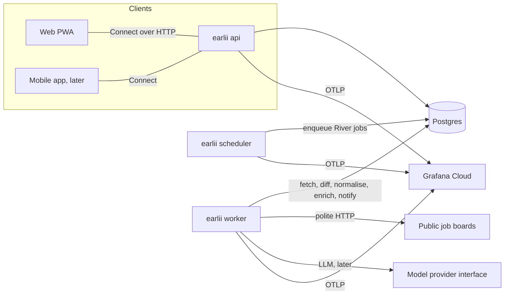

# Earlii developer handbook

Updated incrementally, as part of every PR that changes what it describes. Sections for things not built yet say **(planned, <ID>)**.

## 1. Orientation

Earlii polls public company job boards, detects new roles within minutes, normalises them for India, and serves a personal feed and alerts. Read in this order: SPEC (`docs/SPEC.md`: what and why; **private, local-only and gitignored**, so it isn't on GitHub) → [ROADMAP](ROADMAP.md) (what's next) → [POINTER](POINTER.md) (where we are) → this handbook (how it works) → [CODING_STANDARDS](CODING_STANDARDS.md).

One person maintains everything, with AI help. Optimise for code that is easy to change, test and operate, not for code that is clever.

## 2. Glossary

| Term | Meaning |
| :-- | :-- |
| Board | One company's careers feed at one provider (e.g. a Greenhouse board token) |
| Provider | A job-board/ATS vendor with a public API (Greenhouse, Lever, …) |
| Connector | Code that reads one provider's public feed into raw postings |
| Posting | A job as published. It has a **stable ID** from the provider and **versions** keyed by content hash |
| First seen | When Earlii first saw a posting: the freshness clock |
| Region pack | Per-country data and rules: location tree, title/salary/experience rules, connector list |
| Enrichment | Per-posting-version LLM extraction, where every field has a verbatim evidence quote or "not stated" |
| Mode | The role a single `earlii` binary runs as: `api`, `worker` or `scheduler` |
| POINTER | `docs/POINTER.md`, the session handoff file |
| BP-xxx | A bug from an earlier PR, queued in POINTER's FIX-FIRST QUEUE |
| SCP-xx | A Spec change proposal (ROADMAP) |
| D-xx | An open or closed decision (ROADMAP section Decisions) |
| Decision story | An interview-ready write-up of a technical decision (`docs/learning/STORIES.md`) |

## 3. Repo map

```text
earlii/
├── AGENTS.md                 Agent instructions (single source); CLAUDE.md imports it
├── Taskfile.yml              Task runner: setup, doctor, check, fmt, lint, test, handoff
├── mise.toml                 Tool version pins (local + CI)
├── lefthook.yml              Git hooks: format, secrets, commit-msg, pre-push
├── biome.json                TS/JS/JSON/CSS format + lint (Markdown excluded)
├── .golangci.yml             Go lint + formatters (gofumpt, goimports)
├── package.json              pnpm workspace root: Biome, TypeScript, Vite, Vitest (exact pins)
├── tsconfig.base.json        Shared strict TS options; every TS project extends it and adds the @/* alias (ADR-0004)
├── pnpm-workspace.yaml       Workspace globs: apps/*, packages/*
├── scripts/                  Repo automation, zero dependencies, tested with node:test
│   ├── lib/                  Pure logic: conventional commits, guards, handoff, pins, shell parsing
│   ├── claude/               Claude Code hook entry points (session-start, guard-bash, guard-edit, post-edit-format)
│   ├── test/                 Tests for all of the above, plus config-parsing tests
│   │   └── fixtures/ts-alias/ Reference TS project proving @/* in tsc, Vitest, Vite dev and build
│   ├── check-text.mjs        Banned-character scan (the section sign) for files and staged changes
│   ├── doctor.mjs            Tool pin check
│   ├── handoff-check.mjs     POINTER/HANDBOOK rule (CI + local)
│   ├── commit-msg.mjs        commit-msg hook
│   └── pre-push-guard.mjs    pre-push hook
├── .claude/                  Claude Code: settings (hooks, permissions, attribution off), skills, subagents
├── .mcp.json                 MCP servers: gopls, playwright, context7 (optional)
├── .github/                  CI workflow, Dependabot, PR template
├── docs/                     Spec, roadmap, pointer, handbook, standards, versions, setup, ADRs, learning
├── backend/                  (planned, P0-02) Go module: cmd/earlii, internal/<module>/
├── apps/web/                 (planned, P0-03) React PWA
├── packages/                 (planned, P0-05 / P2-01) generated API client, design tokens
└── proto/                    (planned, P0-05) Protobuf contracts
```

## 4. Architecture

The architecture is set in ADRs: a **modular monolith** ([ADR-0003](adr/0003-modular-monolith-one-image.md)) built as one Go binary and one Docker image, running in several modes. Contracts are **Connect RPC + Protobuf** ([ADR-0002](adr/0002-connect-rpc-protobuf-contracts.md)).



- **Module boundaries** (planned, P1-01 onward): `internal/<module>/` per bounded area (registry, connectors, pipeline, feed, alerts, auth). Modules talk through Go interfaces in-process, and never by reaching into another module's tables.
- **Async work** goes through River jobs on Postgres. That avoids a separate broker on free tiers.

## 5. Runtime flows

- Boot and shutdown (planned, P0-02)
- Request path: web → Connect → handler → sqlc → Postgres (planned, P0-05)
- Fetch cycle: scheduler → River job → connector → change detection → normalisation (planned, P1-03 – P1-07)
- Alert fan-out: new posting → incremental match → digest/push (planned, P2-12, P2-13)

## 6. Data and content pipeline

(planned, P1-01 – P1-12) Registry → polite fetch → change detection (stable ID + content hash) → India normalisation → dedupe → (Beta) enrichment with evidence → matching.

## 7. Testing strategy

- **Repo scripts:** `node:test` in `scripts/test/`. Pure logic lives in `scripts/lib/`, so the rules are unit-tested without git. The CLIs are also tested end to end through `spawnSync`.
- **Go** (planned, P0-02): table-driven unit tests next to the code; `-race` in CI; integration tests against Postgres (P0-04, D-10); fixtures for connectors, with no live network in CI.
- **Web** (planned, P0-03): Vitest + Testing Library; Playwright e2e for the key flows (P2-04, P2-05).
- **Required paths for every change:** happy, sad, edge and abuser. See CODING_STANDARDS section Tests.

## 8. Performance budgets

The canonical budgets live in [ROADMAP section Budgets](ROADMAP.md#budgets). How each is measured is added here as each budget gets a gate (planned, P0-06, P2-03, P2-07).

## 9. Security model

- **Agent guardrails** (built): hooks deny secret, generated and vendored edits and dangerous git/gh actions; SPEC and LICENSE edits need the human's approval; permission deny rules block reading `.env*`, keys and `secrets/`.
- **Secrets** live only in environment variables or a secret manager, never in the repo. gitleaks runs in pre-commit and CI.
- **Supply chain:** GitHub Actions are pinned by commit SHA and audited by zizmor; Dependabot opens monthly update PRs.
- Application auth, sessions, SSRF defences, HTML sanitisation and DPDP controls (planned, P1-11, P2-09, P2-10, E-08).

## 10. Operations

(planned, P2-17) Deploys, backups, dashboards, alerts and runbooks.

## 11. How-to recipes

- **Start a session:** open Claude Code in the repo root. POINTER is injected automatically. Say "next PR" (`/next-pr`).
- **Add a tool:** pin it in `mise.toml`, add a probe in `scripts/lib/pins.mjs`, record it in `docs/VERSIONS.md`, then run `task doctor`.
- **Add a Claude hook:** put the logic in `scripts/lib/` with tests, keep the entry point thin in `scripts/claude/`, and register it in `.claude/settings.json`. `repo-config.test.mjs` checks the script exists.
- **Bypass the pre-push guard (human only, emergencies):** `EARLII_ALLOW_MAIN_PUSH=1 git push origin main`. Agents are blocked from using it.

## 12. Decision log

| ADR | Title | Status |
| :-- | :-- | :-- |
| [0001](adr/0001-toolchain-and-repo-automation.md) | Toolchain and repo automation (Task, mise, lefthook, Biome, golangci-lint, Node scripts) | Accepted |
| [0002](adr/0002-connect-rpc-protobuf-contracts.md) | Connect RPC + Protobuf contracts | Accepted |
| [0003](adr/0003-modular-monolith-one-image.md) | Modular monolith, one image, many modes | Accepted |
